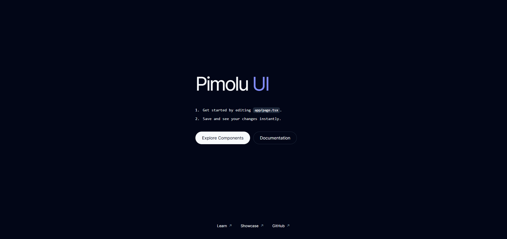

# Pimolu UI: React + Vite Starter



A minimal, independent starter for React, Vite, TypeScript, Tailwind CSS and the published Pimolu UI packages. Pimolu UI is currently in beta. This starter pins its packages to version `0.1.0-beta.3.1`.

## Get started

Use Node.js 22.12 or newer and npm 10 or newer.

```sh
npm install
npm run dev
```

Open the local URL printed by Vite. Edit `src/App.tsx` and save to see your changes instantly.

## Pimolu components and themes

The starter imports `@pimolu/web-styles/styles.css` and wraps the app in `PimoluProvider` in `src/main.tsx`. Import components directly from the installed package:

```tsx
import { Button } from '@pimolu/react'

export function Example() {
  return <Button appearance="outline">Hello Pimolu</Button>
}
```

Browse the [component catalogue](https://pimolu.com/components) and [documentation](https://pimolu.com/docs) for component APIs. The provider follows the system light or dark preference by default. Set `defaultTheme="light"` or `defaultTheme="dark"` in `src/main.tsx` to choose a starting theme. You can also set `defaultStylePreset` to a supported preset such as `"monochrome"` or `"glass"`. See the [theming guide](https://pimolu.com/docs/theming) for token customization. Tailwind utilities work alongside Pimolu CSS variables.

## Checks and production build

```sh
npm run typecheck
npm run lint
npm run build
npm run preview
```

`npm run build` checks TypeScript and writes the static site to `dist/`. Deploy that directory to any static host. To deploy under a subpath, set Vite's `base` in `vite.config.ts` to the public path before building.

## Use this template

On GitHub, select **Use this template**, then **Create a new repository**. Clone your new repository and run the installation commands above. The repository owner must enable GitHub's template setting.
